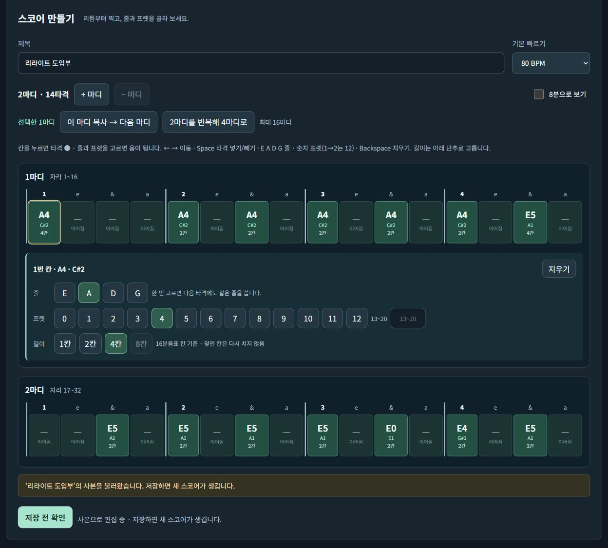
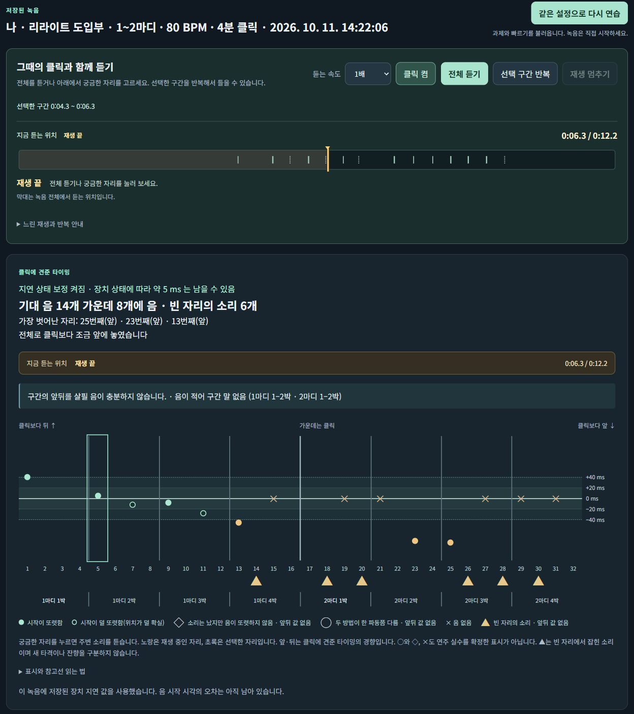

# 生成AIを活用した制作・改善の記録

[ポートフォリオ一覧](../README.md) · [한국어](ai-development-process.ko.md)

公開している画面・資料・結果を基に、制作中の課題、変更した理由、自分と生成AIの役割を整理しました。チャットの全文や当時のプロンプトを転載したものではありません。整理日：2026年10月21日。

## BassLab：自分の練習で感じた不便を改善する

基礎練習と自分の演奏の振り返りを一か所で行うための個人制作です。私は課題設定、必要な機能と操作の流れの整理、実際の操作・録音による動作確認、修正内容の指示を行い、コードの実装は生成AIに任せました。

**使って不便を見つける → 要件として整理する → AIに実装・修正を依頼する → 自分で操作して確かめる**、という流れで段階的に改善しました。

### 開発の経緯

下の5段階は機能と構成の変化です。アプリ全体を5回作り直したという意味ではありません。

| 段階 | 課題・変更したこと | 確認できる構成・機能 |
|---|---|---|
| 2025年：Streamlit・librosa | 自分の演奏を基準のリズムと比べたい | 録音ファイルと、秒単位で手入力した基準時刻を比較 |
| 次の試作：FastAPI・React | 画面と分析処理を分ける | アップロード画面と分析API。この時点では録音分析が中心 |
| 2026年：PWA | 分析だけでなく、日々の基礎練習も行いたい | 聴音・音程・和声・リズム・複合練習、ミッションや練習記録 |
| Windowsでの録音・分析 | ブラウザーでは録音遅延が一定でなかった | C++・WASAPIで録音し、遅延の測定値と設定を保存 |
| スコアとの接続 | 練習したいフレーズを秒数で入力するのが不便 | 弦・フレット・リズムを楽譜グリッドに入力し、録音・分析・聴き直しへ接続 |

[各段階の構成と理由を見る](https://seunghun-data-portfolio.lsrrokmv.chatgpt.site/works/basslab.html#bass-growth)

### 変更例：秒数の手入力から、楽譜の入力へ

最初の分析ツールでは、比較したいリズムを秒数で手入力していました。自分が練習したい短いフレーズを指定しやすくするため、楽譜グリッドで入力する操作を要件にし、編集・保存した楽譜を録音の課題につなげました。

アプリ本体の画面は韓国語です。以下の説明は、画像に写っている操作と結果を日本語で案内しています。

① **楽譜を入力する：** 弦・フレット・リズムをグリッドで指定します。  
② **練習条件をそろえる：** 小節数やBPMとともに楽譜を保存し、録音の課題に使います。  
③ **次の操作につなぐ：** 入力した楽譜から、演奏の録音と結果確認へ進みます。

① **課題と録音を対応させる：** 保存した楽譜と録音結果を確認します。  
② **候補と根拠を見る：** 音の候補、予定位置、開始時刻の判断を分けて表示します。  
③ **該当区間を聴き直す：** 結果を正解と決めつけず、実際の音と照らし合わせます。

### 何を確認できたか

5種類の基礎練習に加え、自分で入力した楽譜を録音・聴き直しにつなぐ流れを作りました。2026年10月11日には、2小節・80 BPM・予定打音14個の楽譜を使った録音3件が保存されています。約2分間に続けて行ったスコア連携の動作確認です。

画像は実際のアプリのコピーを操作して撮影し、結果画面には保存済みの録音結果を使用しました。各場面は別々に撮影しており、この撮影時に新しい楽器録音は行っていません。

Windowsへの変更は録音遅延を扱う方式の改善です。タイミング分析の精度を実証したものではなく、2026年9月30日のベンチマークは事前に定めた基準を満たしませんでした。現在は自動採点ではなく、次の練習で確かめる箇所を見つけるために結果を使っています。

[入力・コードの流れ・結果の実例を見る](https://seunghun-data-portfolio.lsrrokmv.chatgpt.site/works/basslab.html#materials)

## 金融ニュースRAG：全工程を一人で進めた個人プロジェクト

2025年にLLM講座の受講中、目的設定、ニュース・ETF価格データの収集、LangGraphの処理フローの設計、実装、結果の確認、発表まで一人で進めました。実装には生成AIを活用しました。メンターの助言を受けながら、ニュースを探すことに加え、価格と出典を確認できるレポートにする方向へ整理しました。

| 時点 | 処理と確認の内容 |
|---|---|
| 2025年の制作 | 質問整理 → BM25・ベクトル・Naver検索 → 統合・再順位付け → 価格・過去の類似事例の接続 → 説明文生成。数値はpandasで計算し、LLMは検索語の書き換えと説明文の生成に使用 |
| 2026年の追加整備・再検証 | 生成AIの支援を受け、保存データで再実行。現在公開している検索・価格結果はBM25 → BGE-M3の実行で、LLMは呼び出していない。検索順序へのスコア反映やETFごとの価格日の対応を確認 |

現在の公開結果は、2025年当時のLangGraph実行そのものではありません。記事・ETF・価格日・計算結果が同じ実行の記録へつながる形で公開しています。

- [制作時の役割と現在の処理を読む](https://seunghun-data-portfolio.lsrrokmv.chatgpt.site/works/financial-rag.html)
- [使用データとコードの流れ](https://seunghun-data-portfolio.lsrrokmv.chatgpt.site/works/financial-rag.html#materials)
- [現在の検索・価格結果](https://seunghun-data-portfolio.lsrrokmv.chatgpt.site/results/financial-rag.html) · [同じ実行のresult.json](https://seunghun-data-portfolio.lsrrokmv.chatgpt.site/results/data/financial-rag/result.json)

結果ページには別の入力で行ったAI試験もあります。上記の検索・価格結果とは別の実行として区別しています。
